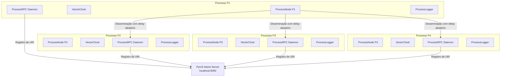
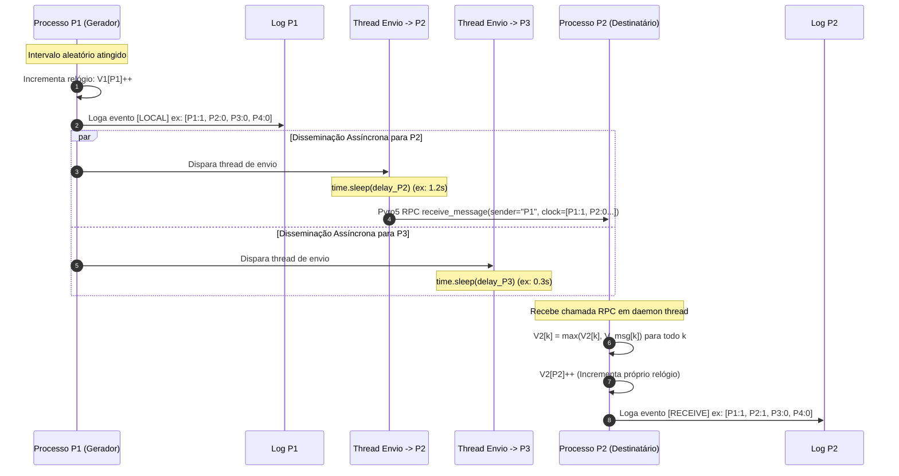

# 📘 Documentação de Arquitetura e Fluxo do Sistema

Este documento descreve detalhadamente o funcionamento de cada módulo e o fluxo de execução do **Sistema Distribuído de Relógios Vetoriais** usando **Python** e **Pyro5**.

---

## 🏗️ 1. Visão Geral da Arquitetura

O sistema é composto por 4 processos independentes ($P_1, P_2, P_3, P_4$) que executam concorrentemente. Cada processo possui seu próprio servidor RPC Pyro5, seu gerador de eventos e seu relógio vetorial local.

---

## 🧩 2. Detalhamento dos Módulos

### 2.1. `src/vector_clock.py` — Gerenciador do Relógio Vetorial

Este módulo implementa a classe `VectorClock`, responsável por manter o vetor de inteiros $V = [V[P_1], V[P_2], V[P_3], V[P_4]]$ para o processo local.

#### Principais Funcionalidades:
- **Thread-Safety**: Utiliza um `threading.Lock()` interno para garantir que requisições RPC concorrentes e a thread local de geração de eventos não corrompam o estado do relógio.
- **`increment()`**: Executado quando o processo gera um evento local ou envia uma mensagem:
  $$V_i[i] = V_i[i] + 1$$
- **`update_on_receive(received_clock)`**: Executado ao receber uma mensagem contendo o relógio do remetente $V_{msg}$:
  1. Atualização elemento a elemento: $V_i[k] = \max(V_i[k], V_{msg}[k])$ para todo $k$.
  2. Incremento da posição local para registrar o evento de recepção: $V_i[i] = V_i[i] + 1$.
- **`compare(v1, v2)`**: Compara dois relógios vetoriais e classifica a relação causal:
  - **`EQUAL`**: $V_1 == V_2$
  - **`PRECEDES` ($V_1 < V_2$)**: $\forall k, V_1[k] \le V_2[k]$ e $\exists k, V_1[k] < V_2[k]$ ($V_1$ causou/antecedeu $V_2$).
  - **`SUCCEEDS` ($V_1 > V_2$)**: $\forall k, V_1[k] \ge V_2[k]$ e $\exists k, V_1[k] > V_2[k]$ ($V_2$ causou/antecedeu $V_1$).
  - **`CONCURRENT` ($V_1 \parallel V_2$)**: Nem $V_1 \le V_2$ e nem $V_2 \le V_1$ (eventos ocorreram sem relação direta de causa e efeito).

---

### 2.2. `src/logger.py` — Logger Formatado e Persistência

Este módulo centraliza o registro e exibição de logs em tempo real.

#### Principais Funcionalidades:
- **Formatação ANSI**: Atribui cores exclusivas para cada processo ($P_1$: Ciano, $P_2$: Verde, $P_3$: Amarelo, $P_4$: Magenta) e destaca os tipos de evento (`[LOCAL]`, `[SEND]`, `[RECEIVE]`).
- **Persistência Individual**: Grava o histórico textual no arquivo `logs/process_P*.log`.
- **Persistência Estruturada**: Apenda os eventos em formato JSON em `logs/events_log.json`, contendo o ID do processo, número do evento, timestamp ISO e epoch, relógio vetorial e detalhes da operação.

---

### 2.3. `src/process_node.py` — Nó de Processo Distribuído

Cada processo no sistema é representado por um objeto `ProcessNode`.

#### Principais Funcionalidades:
- **Servidor RPC Pyro5**: A classe auxiliar `@Pyro5.api.expose class ProcessRPC` expõe o método `receive_message(...)` via RPC.
- **Registro no Name Server**: O nó inicializa um `Pyro5.api.Daemon` em uma porta dinâmica e registra seu nome (ex: `"P1"`) no NameServer Pyro5 (`localhost:9090`).
- **Loop de Geração de Eventos**: Uma thread em background executa a cada intervalo aleatório (configurável, ex: 1.2s a 2.5s):
  1. Chama `vector_clock.increment()`.
  2. Registra o evento local no log.
  3. Dissemina o evento para todos os pares ($P_j \neq P_i$).
- **Disseminação Assíncrona com Atraso Simulado (`_disseminate_to_peer`)**:
  - Para cada destinatário, o processo cria uma **thread separada**.
  - A thread aguarda um `time.sleep(random.uniform(min_delay, max_delay))` aleatório (ex: 0.3s a 1.5s).
  - Em seguida, estabelece conexão Pyro5 via `Pyro5.api.Proxy("PYRONAME:<peer_id>")` e invoca `receive_message(...)`.
  - *Resultado*: Como o delay de envio para cada nó é independente, destinatários recebem mensagens em ordens totalmente diferentes!

---

### 2.4. `src/causal_analyzer.py` — Analisador de Causalidade e Concorrência

Executado automaticamente ao final da simulação ou via utilitário independente `analyze_logs.py`.

#### Principais Funcionalidades:
- Carrega todos os eventos registrados em `logs/events_log.json`.
- Ordena-os no tempo físico de ocorrência.
- Realiza uma comparação par a par de todos os eventos utilizando `VectorClock.compare(...)`.
- Filtra e exibe no terminal a lista de todos os **Pares Concorrentes** ($E_1 \parallel E_2$), provando quais eventos ocorreram simultaneamente no sentido causal.

---

### 2.5. `main.py` — Orquestrador CLI Principal

Ponto de entrada do sistema.

#### Principais Funcionalidades:
1. **Subida do Name Server**: Inicializa o NameServer do Pyro5 em uma thread secundária na porta `9090`.
2. **Limpeza**: Reseta o diretório `logs/`.
3. **Instanciação**: Cria os 4 nós de processo ($P_1, P_2, P_3, P_4$) e inicia seus servidores RPC.
4. **Execução**: Dispara as threads de simulação e aguarda o tempo estipulado (`--duration 30`).
5. **Encerramento e Análise**: Desliga graciosamente os Daemons RPC, remove registros do NameServer e chama o `CausalAnalyzer`.

---

## 🔄 3. Fluxo de Execução de um Evento (Passo a Passo)

Abaixo está a sequência completa de acontecimentos quando um evento é gerado e disseminado:

1. **Geração do Evento Local em $P_1$**:
   - $P_1$ acorda do `time.sleep` do gerador.
   - Incrementa seu relógio: $V_{P1} = [1, 0, 0, 0]$.
   - Imprime e salva no log local o evento `LOCAL`.

2. **Criação das Threads de Disseminação**:
   - $P_1$ dispara 3 threads independentes de envio (uma para $P_2$, uma para $P_3$, uma para $P_4$).

3. **Atraso Simulado de Rede**:
   - A thread destinada a $P_3$ aguarda 0.3s.
   - A thread destinada a $P_2$ aguarda 1.2s.
   - Assim, $P_3$ processará a mensagem bem antes de $P_2$.

4. **Recepção no Destinatário ($P_2$)**:
   - O daemon Pyro5 de $P_2$ intercepta a chamada RPC `receive_message`.
   - $P_2$ aplica as regras de merge:
     $$\begin{aligned}
     V_{P2}[k] &= \max(V_{P2}[k], V_{msg}[k]) \\
     V_{P2}[P_2] &= V_{P2}[P_2] + 1
     \end{aligned}$$
   - $P_2$ grava no seu log local o evento `RECEIVE`.

5. **Análise Pós-Simulação**:
   - O `CausalAnalyzer` lê todos os eventos e identifica que se dois eventos $E_x$ e $E_y$ ocorreram sem que o relógio de um dominasse o outro, eles são marcados e exibidos como **Eventos Concorrentes** ($E_x \parallel E_y$).
